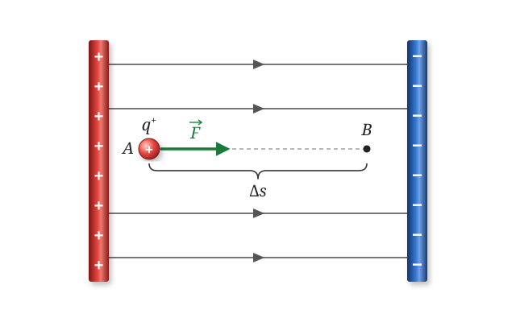
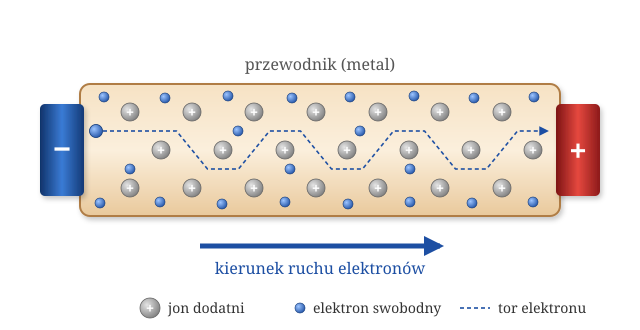

= Napięcie i natężenie prądu elektrycznego
:lang: pl
:toc: left
:toc-title: Spis treści
:sectnums:
:stem: latexmath
:icons: font
:figure-caption: Rysunek
:note-caption: Uwaga

== Napięcie elektryczne

Napięcie elektryczne możemy rozpatrywać z dwóch perspektyw:

* jako *różnicę potencjałów*,
* jako *pracę*, jaką wykonują siły pola elektrycznego, aby przenieść ładunek umieszczony w tym polu między dwoma punktami tego pola.

=== Napięcie jako praca sił pola

Napięcie elektryczne charakteryzuje pole elektrostatyczne (nazywane czasem po prostu polem elektrycznym) pod względem energetycznym.

Zanim wprowadzimy tę wielkość, rozpatrzmy następującą sytuację.
Mamy dwie naelektryzowane płytki.
W pobliżu dodatnio naładowanej płytki metalowej, w punkcie _A_, umieszczamy dodatni ładunek próbny stem:[q^{+}].
Pod wpływem siły pola elektrostatycznego ładunek ten porusza się w stronę punktu _B_, leżącego w pobliżu płytki naelektryzowanej ładunkiem ujemnym.

.Ładunek próbny przenoszony przez siłę pola elektrostatycznego z punktu A do punktu B

NOTE: Pole nazywamy *elektrostatycznym*, ponieważ jest wytworzone przez ładunki (układ ładunków) pozostające w spoczynku.

NOTE: Ładunek próbny _q_ jest na tyle mały, że nie zakłóca pola elektrycznego, w którym jest umieszczony.

Na ładunek próbny umieszczony w polu elektrostatycznym działają siły tego pola, a to z kolei powoduje ruch (przenoszenie) tego ładunku.
Oznaczmy literą _W_ pracę siły pola elektrycznego wykonaną podczas przenoszenia ładunku _q_ od punktu _A_ do punktu _B_.

Stosunek tej pracy do przenoszonego ładunku elektrycznego oznaczamy literą _U_ i nazywamy *napięciem elektrycznym* między punktami _A_ i _B_ pola elektrostatycznego.

[IMPORTANT]
.Definicja
====
[stem]
++++
U = \frac{W}{q}
++++

*Napięcie elektryczne między dwoma punktami pola elektrostatycznego obliczamy, dzieląc pracę W, którą wykonały siły pola działające na ładunek q na drodze między tymi punktami, przez wartość tego ładunku.*
====

Jednostką napięcia jest jeden wolt – *V*.

[stem]
++++
1\,\mathbf{[V]} = \frac{1\,\mathbf{[J]}}{1\,\mathbf{[C]}}
++++

Napięcie mierzymy woltomierzem lub miernikiem uniwersalnym.

*Napięcie między dwoma punktami pola elektrostatycznego równe jest jednemu woltowi, jeżeli siła pola wykonuje nad ładunkiem jednego kulomba pracę jednego dżula.*

[TIP]
.Warto się zastanowić: większa odległość między punktami
====
Co się stanie, jeśli oddalimy punkt _B_ od punktu _A_?

Jeśli oddalimy punkt _B_ od punktu _A_ w stronę płytki ujemnej (wzdłuż linii pola), napięcie między tymi punktami wzrośnie.
Ładunek przebędzie wtedy dłuższą drogę stem:[\Delta s], więc siły pola wykonają nad nim większą pracę _W_.
====

[TIP]
.Warto się zastanowić: większy ładunek próbny
====
Co się stanie, jeśli w punkcie _A_ umieścimy dwa razy większy ładunek?

Ładunek 2 C możemy traktować jak dwa ładunki po 1 C połączone razem.
Pole działa na każdy z nich dokładnie tak samo, więc łączna siła działająca na ładunek 2 C jest dwa razy większa.
Podobnie na ładunek trzy razy większy pole działa siłą trzy razy większą.
Siła, z jaką pole działa na ładunek, jest więc wprost proporcjonalna do wartości tego ładunku.

Skoro siła jest większa, a droga od _A_ do _B_ pozostaje taka sama, to siły pola wykonują większą pracę.
Dlatego *praca jest tym większa, im większy jest poruszający się ładunek elektryczny.*

Zobaczmy to na przykładzie (punkty _A_ i _B_ są cały czas w tych samych miejscach):

[cols="1,1,1",options="header",width=60%,align=center]
|===
| Ładunek _q_ | Praca sił pola _W_ | Napięcie stem:[U = \frac{W}{q}]
| 1 C | 6 J | 6 V
| 2 C | 12 J | 6 V
| 3 C | 18 J | 6 V
|===

_W prawdziwych doświadczeniach ładunek próbny jest dużo mniejszy niż 1 C. Liczby w tabelce dobraliśmy tak, żeby łatwo się liczyło._

Praca rośnie tyle samo razy co ładunek, dlatego ich stosunek, czyli napięcie, się nie zmienia.
Napięcie mówi nam, ile pracy przypada na *jeden kulomb* ładunku.
Opisuje więc samo pole elektrostatyczne, a nie ładunek, który w nim umieściliśmy.
====

[TIP]
.Warto się zastanowić: mocniej naelektryzowane płytki
====
Co się stanie, jeśli płytki będą mocniej naelektryzowane, a ładunek próbny _q_ i położenie punktów _A_ i _B_ pozostaną bez zmian?

Napięcie między punktami _A_ i _B_ wzrośnie, ponieważ:

. mocniej naelektryzowane płytki wytwarzają silniejsze pole,
. silniejsze pole działa na ten sam ładunek większą siłą,
. większa siła na tej samej drodze stem:[\Delta s] wykonuje większą pracę _W_,
. w ilorazie stem:[\frac{W}{q}] licznik rośnie, a mianownik się nie zmienia, więc napięcie rośnie.

*Przykład.* Przy słabiej naelektryzowanych płytkach pole wykonuje nad ładunkiem 1 C pracę 6 J, czyli stem:[U = 6\,\mathrm{V}].
Jeśli płytki naelektryzujemy tak mocno, że siła wzrośnie dwukrotnie, praca wyniesie 12 J, a napięcie stem:[U = 12\,\mathrm{V}].

*Jaki jest skutek dwukrotnego wzrostu siły?*

*1. Ładunek między płytkami (rysunek 1).*
Ładunek porusza się w powietrzu i nic go nie hamuje. Dwukrotnie większa siła powoduje, że:

* ładunek uzyskuje dwukrotnie większe przyspieszenie, czyli szybciej się rozpędza,
* siły pola wykonują nad nim dwukrotnie większą pracę,
* praca ta zamienia się w energię kinetyczną ładunku, więc w punkcie _B_ ma on dwukrotnie większą energię kinetyczną.

Dwukrotny wzrost energii kinetycznej nie oznacza dwukrotnego wzrostu prędkości.
Energia kinetyczna zależy od kwadratu prędkości, stem:[E_k = \frac{mv^2}{2}], dlatego prędkość ładunku w punkcie _B_ wzrośnie tylko około 1,4 raza (stem:[\sqrt{2} \approx 1{,}41]).

*2. Elektrony w przewodzie (rysunek 2).*
W metalu (np. w drucie miedzianym, który bardzo dobrze przewodzi prąd) elektrony nie rozpędzają się bez końca, ponieważ stale zderzają się z atomami przewodnika.
Pod wpływem napięcia przesuwają się powoli (dryfują), ze średnią prędkością rzędu ułamków milimetra na sekundę.
Elektrony mają ładunek ujemny, dlatego poruszają się w stronę przeciwną niż dodatni ładunek próbny z rysunku 1.
Większe napięcie powoduje:

* szybszy średni przepływ elektronów,
* większy ładunek przepływający przez przewodnik w każdej sekundzie, czyli większe natężenie prądu (np. żarówka świeci jaśniej).

*Napięcie jest więc przyczyną przepływu prądu, a natężenie prądu jego skutkiem.*
====

.Ruch elektronów swobodnych w przewodniku między jonami dodatnimi

*Podsumowanie: od czego więc zależy napięcie?*

* od położenia punktów _A_ i _B_, czyli od tego, jak daleko od siebie leżą wzdłuż linii pola,
* od samego pola, czyli od tego, jak mocno naelektryzowane są płytki: silniejsze pole oznacza większą siłę na każdym kulombie i większe napięcie,
* nie zależy natomiast od wartości ładunku próbnego, ponieważ praca rośnie tyle samo razy co ładunek.

=== Napięcie jako różnica potencjałów

Napięcie powstaje wtedy, gdy ładunki elektryczne zostaną rozdzielone: w jednym miejscu (np. na jednej płytce lub na jednym biegunie baterii) gromadzi się nadmiar elektronów, a w drugim powstaje ich niedobór.
Rozdzielone ładunki wytwarzają pole elektryczne, a między punktami tego pola występuje różnica potencjałów.

Po połączeniu tych miejsc przewodnikiem elektrony przepływają z miejsca, gdzie jest ich *nadmiar*, do miejsca, gdzie jest ich *niedobór*.
Przepływ trwa, dopóki potencjały się nie wyrównają, czyli dopóki nie zniknie *nadmiar* i *niedobór* elektronów.

NOTE: Inaczej jest w przypadku baterii.
Zachodzące w niej reakcje chemiczne przez cały czas na nowo rozdzielają ładunki, dlatego potencjały jej biegunów się nie wyrównują.
*Nadmiar* i *niedobór* elektronów na biegunach utrzymują się, więc bateria może zasilać obwód przez długi czas, aż do rozładowania.

== Natężenie prądu elektrycznego
